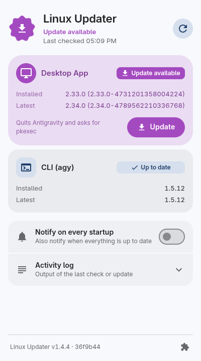
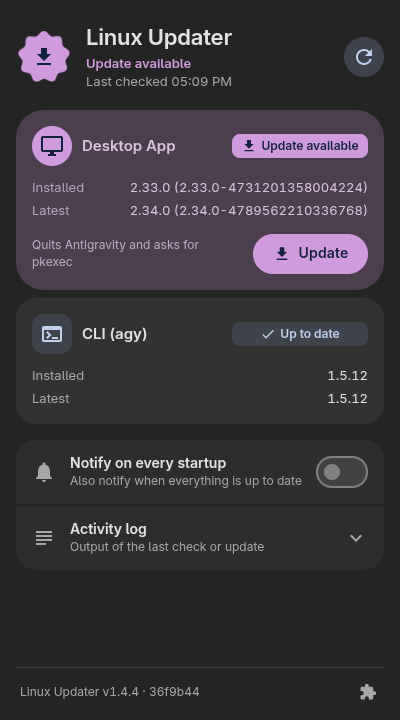
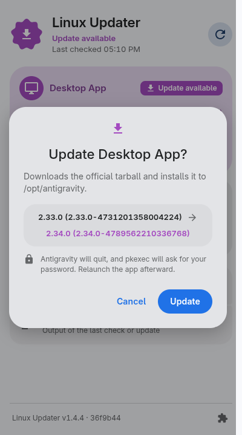
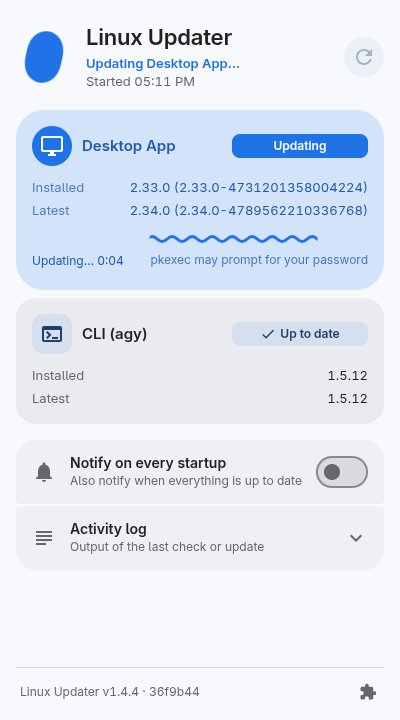
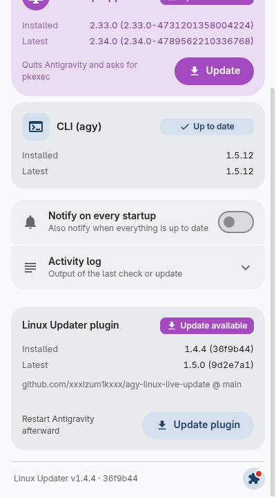

<p align="center">
  
</p>

<h1 align="center">Linux Updater</h1>

<p align="center">
  Install, check, and update <a href="https://antigravity.google/download/">Google Antigravity</a> on Linux:<br>
  the desktop App in <code>/opt</code>, the <code>agy</code> CLI, and a Material 3 Expressive Sidecar panel.
</p>

<p align="center">
  
  
  
</p>

<p align="center"><b>English</b> · <a href="README.zh-CN.md">简体中文</a></p>

<table>
  <tr>
    <td></td>
    <td></td>
  </tr>
</table>

<table>
  <tr>
    <td align="center"><br><sub>Confirm before updating</sub></td>
    <td align="center"><br><sub>Update in progress</sub></td>
    <td align="center"><br><sub>Plugin self-update</sub></td>
  </tr>
</table>

> [!NOTE]
> The panel UI is English-only. This is a community project, not an official Google product.

## Features

- **FHS install** of the official Linux tarball to `/opt/antigravity`, with launcher, `.desktop` entry, and multi-size icons for GNOME, KDE, and XFCE.
- **Update checks** for the desktop App and the `agy` CLI against the official download page.
- **Sidecar panel** inside Antigravity: per-item update buttons, confirmation dialogs, progress, and an activity log.
- **Desktop notifications** (`notify-send`) when App or CLI updates are available at startup.
- **Plugin self-update** from this GitHub repository, shown as a badge in the panel footer.
- **Slash skills** for the agent: `/check-updates`, `/update-app`, `/update-cli`.

## Quick install

```bash
git clone https://github.com/xxxizum1kxxx/agy-linux-live-update.git ~/tools/agy-linux-live-update
cd ~/tools/agy-linux-live-update
chmod +x install.sh uninstall.sh scripts/*.sh bin/update-antigravity
./install.sh --yes                # desktop App only (default)
```

The CLI and the plugin need explicit flags:

```bash
./install.sh --app --cli --yes            # App + official CLI
./install.sh --app --cli --plugin --yes   # App + CLI + this plugin
./install.sh --plugin --yes               # plugin + enable the Sidecar
./install.sh --cli --yes                  # CLI only
./install.sh --check                      # print local/remote versions only
```

Writes under `/opt` and `/usr/local` go through **pkexec**.

## What gets installed

| Path | Purpose |
|------|---------|
| `/opt/antigravity` | Expanded official tarball |
| `/opt/antigravity/.build-id` | Remote build id (used for update checks) |
| `/opt/antigravity/chrome-sandbox` | setuid root (Electron sandbox) |
| `/usr/local/bin/antigravity` | Launcher symlink |
| `/usr/local/share/applications/antigravity.desktop` | Desktop entry |
| `/usr/local/share/icons/hicolor/*/apps/antigravity.png` | Multi-size icons |

After installing, the script refreshes `update-desktop-database`, `gtk-update-icon-cache`, `xdg-desktop-menu`, and `kbuildsycoca5|6` when they are present.

Architecture is detected automatically: `x86_64` → `linux-x64`, `aarch64`/`arm64` → `linux-arm`. Requests to the download page use a browser User-Agent to avoid some 403 responses.

## Plugin and Sidecar panel

```bash
./install.sh --plugin --yes
```

This validates and installs the plugin with `agy plugin install`, then enables the Sidecar (`agy-linux-live-update/updater`) in `~/.gemini/config/config.json`. Restart Antigravity and open **Extensions → Linux Updater**.

<details>
<summary>Enable the Sidecar manually</summary>

```bash
mkdir -p ~/.gemini/config
python3 - <<'PY'
import json
from pathlib import Path
p = Path.home() / ".gemini/config/config.json"
cfg = json.loads(p.read_text() or "{}") if p.exists() else {}
cfg.setdefault("sidecars", {})
cfg["sidecars"].pop("linux-updater/updater", None)
cfg["sidecars"]["agy-linux-live-update/updater"] = {"enabled": True}
p.write_text(json.dumps(cfg, indent=2) + "\n")
print("enabled agy-linux-live-update/updater in", p)
PY
```

</details>

### Panel layout

- **Header**: a shape-morphing logo, the overall status, and when the last check ran. The refresh button at the top right runs a fresh check.
- **Desktop App and CLI cards**: installed vs. latest version. When an update is available the card is tinted and an **Update** button appears. Each update asks for confirmation in a dialog, then shows a wavy progress bar and the elapsed time. The CLI card is hidden when `agy` is not installed.
- **Notify on every startup** switch and a collapsible **Activity log**. When something fails, the log row's subtitle turns red.
- **Footer**: the plugin version and commit. A dot on the puzzle icon means a newer plugin is on GitHub; click the icon to open the plugin panel and update from there.

Clicks and state changes never resize the layout. The panel opens with the cached result and refreshes in the background.

### Background check and desktop notifications

When the Sidecar starts, it runs a quiet check and may show a desktop notification through `notify-send` (app name **Antigravity Linux Updater**, Antigravity icon when available).

- **Notify on every startup** off (default): notify only when App or CLI updates are available. The same set of updates is never notified twice.
- **Notify on every startup** on: always notify at startup, with either "Updates available" or "Up to date".
- Plugin updates never trigger notifications; they only show as the footer badge.
- The refresh button in the panel never sends a notification.
- Antigravity has no Sidecar API for in-app badges, so notifications need a running notification daemon (GNOME, KDE, and XFCE ship one). Without it, checks still work and only the notification is skipped.

## Command-line updates

`install.sh` also installs `~/.local/bin/update-antigravity`:

```bash
update-antigravity --check
update-antigravity --app --yes
update-antigravity --cli --yes
```

The core script is `scripts/update-core.sh` (download, then `pkexec scripts/install-root.sh`).

- **CLI**: when `agy` is already installed, updates go through `agy update`, because the official `install.sh` does nothing if the binary exists. The official `install.sh` is only used for a fresh install. After updating, the script checks `agy --version` and exits non-zero if the version did not change.
- **Plugin**: the check resolves the head commit of `main` through the GitHub API, then reads `plugin.json` and downloads the tarball at that exact commit, so results are never served from a stale CDN cache.

## Uninstall

`uninstall.sh` mirrors the `install.sh` flags:

```bash
./uninstall.sh                     # desktop App only (default)
./uninstall.sh --plugin            # plugin + Sidecar + update-antigravity wrapper
./uninstall.sh --cli               # user-local ~/.local/bin/agy
./uninstall.sh --all --yes         # App + CLI + plugin
```

- `--app` uses **pkexec** through `scripts/uninstall-root.sh`: it removes `/opt/antigravity`, the launcher, desktop entry, and icons, then refreshes the caches.
- `--plugin` also clears the updater cache under `~/.cache/antigravity/linux-updater` and the Sidecar data.
- `--cli` keeps the `~/.gemini/antigravity-cli` config data.

## Limitations

- Only the official Linux tarball is supported (no deb/rpm repository).
- Updating the desktop App quits Antigravity and requires `pkexec`.
- The Sidecar stays off until it is enabled in `~/.gemini/config/config.json` (`install.sh --plugin` does this).
- Icon scaling prefers ImageMagick (`magick`/`convert`); without it, the source image is copied into each size directory.
- Desktop notifications need `notify-send` and a notification daemon.

## License

[MIT](LICENSE)
