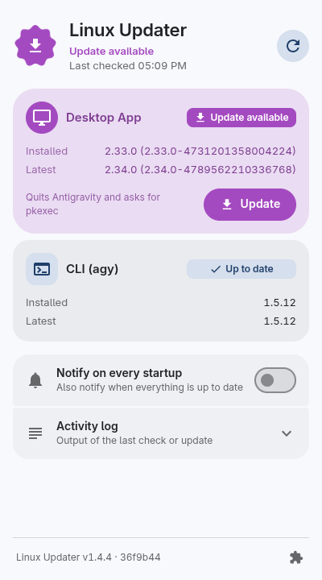
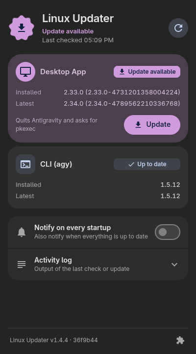
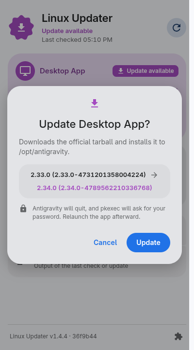
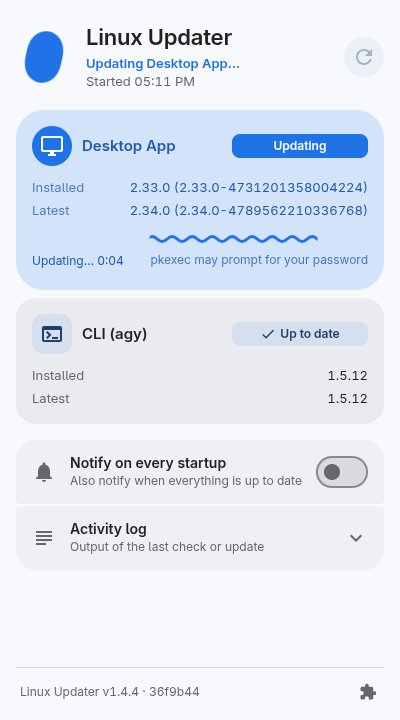
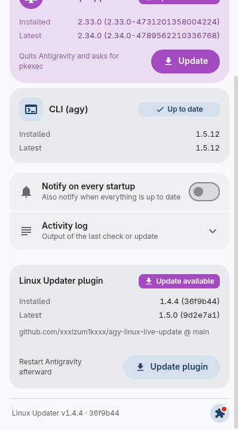

<p align="center">
  
</p>

<h1 align="center">Linux Updater</h1>

<p align="center">
  在 Linux 上安装、检查和更新 <a href="https://antigravity.google/download/">Google Antigravity</a>：<br>
  <code>/opt</code> 下的桌面 App、<code>agy</code> CLI，以及一个 Material 3 Expressive 风格的 Sidecar 面板。
</p>

<p align="center">
  
  
  
</p>

<p align="center"><a href="README.md">English</a> · <b>简体中文</b></p>

<table>
  <tr>
    <td></td>
    <td></td>
  </tr>
</table>

<table>
  <tr>
    <td align="center"><br><sub>更新前确认</sub></td>
    <td align="center"><br><sub>更新进行中</sub></td>
    <td align="center"><br><sub>插件自更新</sub></td>
  </tr>
</table>

> [!NOTE]
> 面板界面只有英文。本项目为社区项目，不是 Google 官方产品。

## 功能

- **FHS 安装**：把官方 Linux tarball 安装到 `/opt/antigravity`，并配好启动器、`.desktop` 文件和多尺寸图标，兼容 GNOME、KDE、XFCE。
- **检查更新**：对照官网下载页，检查桌面 App 和 `agy` CLI 是否有新版本。
- **Sidecar 面板**：在 Antigravity 里直接操作，每一项都有自己的更新按钮，带确认对话框、进度显示和日志。
- **桌面通知**：启动时发现 App 或 CLI 有更新，会通过 `notify-send` 提醒。
- **插件自更新**：从本 GitHub 仓库更新插件，有新版本时面板页脚显示小红点。
- **斜杠技能**：供 agent 使用的 `/check-updates`、`/update-app`、`/update-cli`。

## 快速安装

```bash
git clone https://github.com/xxxizum1kxxx/agy-linux-live-update.git ~/tools/agy-linux-live-update
cd ~/tools/agy-linux-live-update
chmod +x install.sh uninstall.sh scripts/*.sh bin/update-antigravity
./install.sh --yes                # 默认只装桌面 App
```

CLI 和插件需要显式指定参数：

```bash
./install.sh --app --cli --yes            # App + 官方 CLI
./install.sh --app --cli --plugin --yes   # App + CLI + 本插件
./install.sh --plugin --yes               # 插件，并启用 Sidecar
./install.sh --cli --yes                  # 只装 CLI
./install.sh --check                      # 只打印本地和远端版本
```

写入 `/opt` 和 `/usr/local` 时会通过 **pkexec** 请求授权。

## 安装内容

| 路径 | 用途 |
|------|------|
| `/opt/antigravity` | 解压后的官方 tarball |
| `/opt/antigravity/.build-id` | 远端 build id（用于检查更新） |
| `/opt/antigravity/chrome-sandbox` | setuid root（Electron 沙箱） |
| `/usr/local/bin/antigravity` | 启动器软链接 |
| `/usr/local/share/applications/antigravity.desktop` | 桌面入口 |
| `/usr/local/share/icons/hicolor/*/apps/antigravity.png` | 多尺寸图标 |

安装结束后，如果系统里有 `update-desktop-database`、`gtk-update-icon-cache`、`xdg-desktop-menu`、`kbuildsycoca5|6`，脚本会调用它们刷新缓存。

架构自动识别：`x86_64` → `linux-x64`，`aarch64`/`arm64` → `linux-arm`。访问官网下载页时使用浏览器 User-Agent，以避免部分 403。

## 插件与 Sidecar 面板

```bash
./install.sh --plugin --yes
```

这条命令会校验并用 `agy plugin install` 安装插件，然后在 `~/.gemini/config/config.json` 里启用 Sidecar（`agy-linux-live-update/updater`）。重启 Antigravity 后，从 **Extensions → Linux Updater** 打开面板。

<details>
<summary>手动启用 Sidecar</summary>

```bash
mkdir -p ~/.gemini/config
python3 - <<'PY'
import json
from pathlib import Path
p = Path.home() / ".gemini/config/config.json"
cfg = json.loads(p.read_text() or "{}") if p.exists() else {}
cfg.setdefault("sidecars", {})
cfg["sidecars"].pop("linux-updater/updater", None)
cfg["sidecars"]["agy-linux-live-update/updater"] = {"enabled": True}
p.write_text(json.dumps(cfg, indent=2) + "\n")
print("enabled agy-linux-live-update/updater in", p)
PY
```

</details>

### 面板布局

- **顶部**：会变形的 logo、总体状态和上次检查时间。右上角的刷新按钮用于重新检查。
- **Desktop App 和 CLI 卡片**：显示已安装版本和最新版本。有更新时卡片变色，并出现 **Update** 按钮。每次更新前都会弹出对话框确认，执行时显示波浪进度条和已用时间。未安装 `agy` 时不显示 CLI 卡片。
- **Notify on every startup** 开关和可展开的 **Activity log**。出错时日志那一行的副标题会变红。
- **页脚**：插件版本和 commit。拼图图标上出现小红点，表示 GitHub 上有新版插件；点击图标展开插件面板即可更新。

点击和状态切换都不会改变布局尺寸。打开面板时先显示缓存结果，再在后台刷新。

### 后台检查与桌面通知

Sidecar 启动时会静默检查一次，必要时通过 `notify-send` 发送桌面通知（应用名 **Antigravity Linux Updater**，有 Antigravity 图标时使用该图标）。

- **Notify on every startup** 关闭（默认）：只在 App 或 CLI 有更新时通知，同一组更新不会重复通知。
- **Notify on every startup** 开启：每次启动都通知，内容是“有更新”或“已是最新”。
- 插件更新不会发通知，只在页脚显示小红点。
- 在面板里点刷新不会发通知。
- Antigravity 没有提供让 Sidecar 显示应用内角标的接口，所以通知依赖系统的通知服务（GNOME、KDE、XFCE 都自带）。没有通知服务时检查照常进行，只是不弹通知。

## 命令行更新

`install.sh` 还会安装 `~/.local/bin/update-antigravity`：

```bash
update-antigravity --check
update-antigravity --app --yes
update-antigravity --cli --yes
```

核心脚本是 `scripts/update-core.sh`（下载后通过 `pkexec scripts/install-root.sh` 安装）。

- **CLI**：已安装 `agy` 时用 `agy update` 更新，因为官方 `install.sh` 发现文件已存在就会直接退出、什么也不做；只有首次安装才用官方 `install.sh`。更新后脚本会核对 `agy --version`，版本没变就以非 0 退出。
- **插件**：检查时先通过 GitHub API 取得 `main` 的最新 commit，再读取该 commit 下的 `plugin.json`、下载该 commit 的 tarball，因此不会读到 CDN 缓存里的旧版本。

## 卸载

`uninstall.sh` 的参数与 `install.sh` 对应：

```bash
./uninstall.sh                     # 只卸载桌面 App（默认）
./uninstall.sh --plugin            # 插件 + Sidecar + update-antigravity
./uninstall.sh --cli               # 用户目录下的 ~/.local/bin/agy
./uninstall.sh --all --yes         # App + CLI + 插件
```

- `--app` 通过 **pkexec** 调用 `scripts/uninstall-root.sh`：删除 `/opt/antigravity`、启动器、桌面入口和图标，并刷新缓存。
- `--plugin` 还会清理 `~/.cache/antigravity/linux-updater` 下的缓存和 Sidecar 数据。
- `--cli` 会保留 `~/.gemini/antigravity-cli` 中的配置数据。

## 限制

- 只支持官方 Linux tarball（没有 deb/rpm 软件源）。
- 更新桌面 App 会退出 Antigravity，并需要 `pkexec`。
- Sidecar 需要在 `~/.gemini/config/config.json` 中启用才会运行（`install.sh --plugin` 会自动启用）。
- 缩放图标优先使用 ImageMagick（`magick`/`convert`）；没有时直接把原图复制到各尺寸目录。
- 桌面通知需要 `notify-send` 和系统通知服务。

## 许可证

[MIT](LICENSE)
